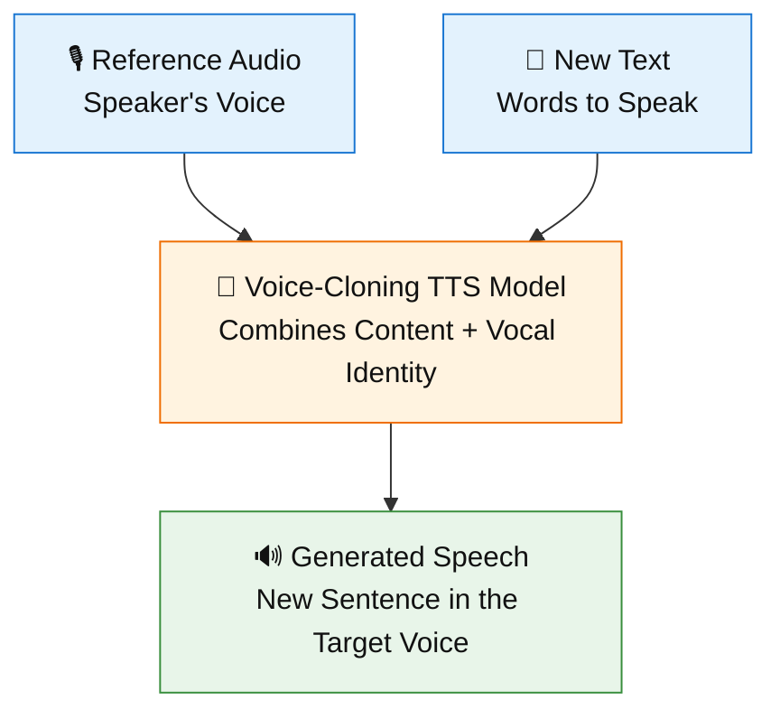
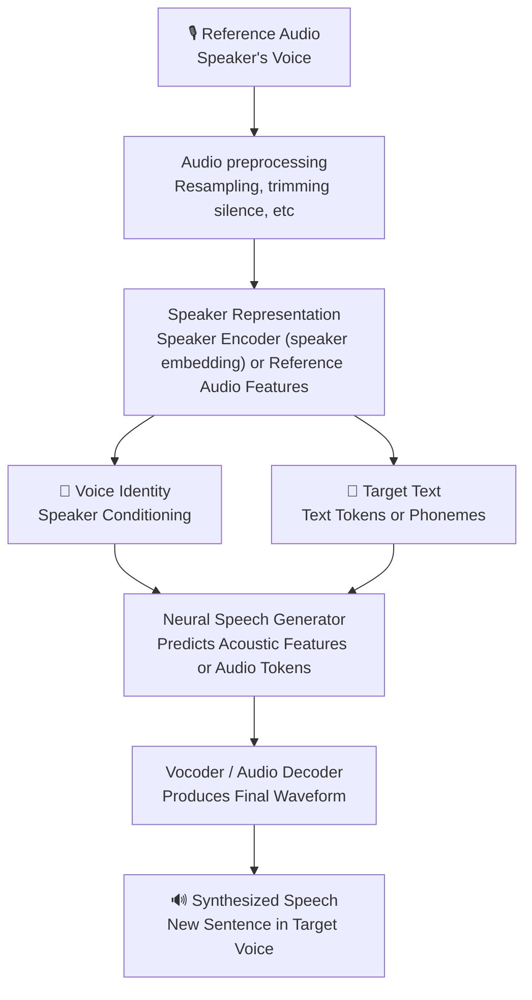

# Voice Cloning
Voice cloning is a form of speech synthesis that generates new speech resembling a specific person's voice.

## Three types of voice cloning
| Technique | Input | What it does |
|---|---|---|
| Zero-shot / few-shot TTS | Text + short reference audio | Clones an unfamiliar voice without updating model weights |
| Fine-tuned voice cloning | Text + larger voice dataset | Adapts model parameters to a specific speaker |
| Voice conversion | Source speech + target voice | Changes who appears to be speaking while preserving the words |

For reference, ElevenLabs recommends 1–2 minutes of good audio for its instant cloning product and 30–180 minutes for professional cloning.

Zero-shot means the model can generalize to a new speaker without training specifically on that speaker.

### What is a speaker embedding?
An audio encoder can transform a speech recording into a fixed-dimensional vector representing speaker characteristics like timbre and accent.

## Which models and tools should you know?
ElevenLabs: Managed API and hosted voice-cloning products. Useful for quickly evaluating quality without managing GPU infrastructure.

## How do you evaluate voice cloning?
| Metric | What it answers | How |
|---|---|---|
| Speaker similarity | Does it sound like the target person? | Speaker embeddings + cosine similarity |
| MOS/naturalness | Does it sound like natural speech? | Human listener ratings |
| WER | Were the intended words spoken correctly? | ASR transcript compared with target text | 
| Latency / RTF	| Is generation fast enough? | Runtime measurement |

Also, high speaker similarity does not guarantee naturalness.

## NeMo NanoCodec
The NeMo NanoCodec is a neural audio codec that leverages finite scalar quantization and adversarial training with large speech language models to achieve state-of-the-art audio compression across different bitrate and frame rate ranges.

NeMo NanoCodec is like a ZIP file for human voices. But instead of compressing text or pictures, it compresses sound.

Imagine you record yourself saying: "Hello! How are you today?"

Your voice contains thousands of tiny sound measurements. That's a lot of information!

NanoCodec does three things:

1. Listens to your voice and figures out what the sound is like.
2. Turns it into a small collection of numbers (called audio tokens), instead of keeping all those sound measurements.
3. Turns those numbers back into sound, trying to make it sound just like your original voice.

Why is it special?

magine another AI needs 100 little steps to make one second of speech.

NanoCodec can represent one second of speech using only 12.5 frames.

That means a speech-generating AI can produce audio with fewer sequential steps, potentially making it speak much faster.

- Finite Scalar Quantization(FSQ): Choosing numbers from a limited set, like rounding 3.78 to 4, to make sound information smaller.
- Adversarial training: Another neural network acts like a teacher, judging whether the recreated sound sounds real. The codec learns to fool that teacher.
- Bitrate: How much information is used to store one second of audio. Smaller means more compression.
- Frame rate: How many little chunks of sound the codec produces per second.
