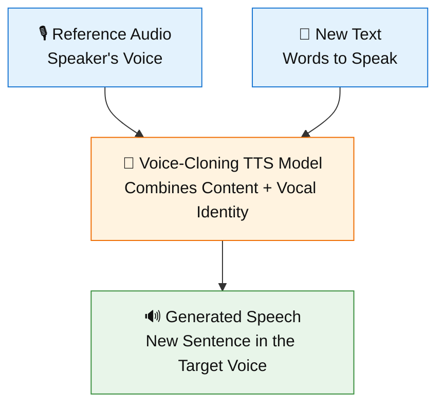
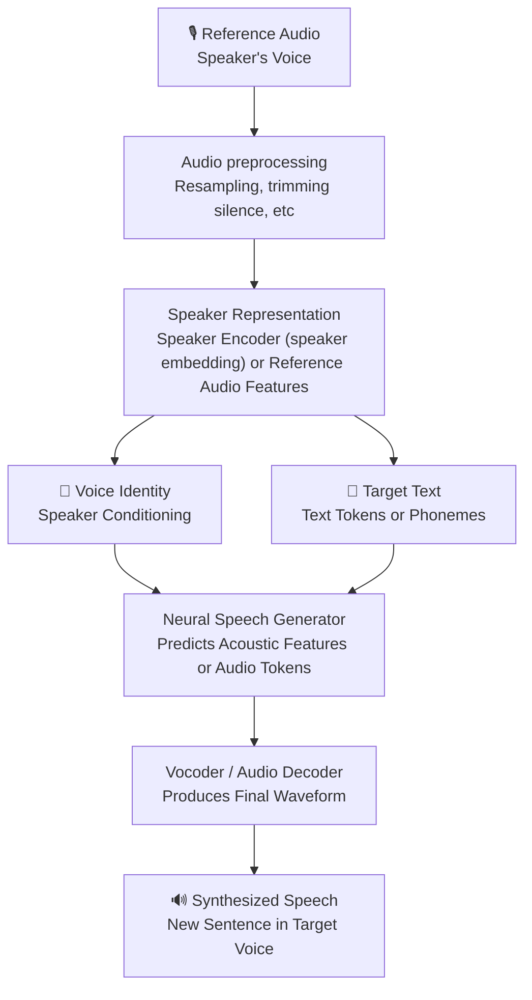

# Voice Cloning
Voice cloning is a form of speech synthesis that generates new speech resembling a specific person's voice.

## Three types of voice cloning
| Technique | Input | What it does |
|---|---|---|
| Zero-shot / few-shot TTS | Text + short reference audio | Clones an unfamiliar voice without updating model weights |
| Fine-tuned voice cloning | Text + larger voice dataset | Adapts model parameters to a specific speaker |
| Voice conversion | Source speech + target voice | Changes who appears to be speaking while preserving the words |

For reference, ElevenLabs recommends 1–2 minutes of good audio for its instant cloning product and 30–180 minutes for professional cloning.

Zero-shot means the model can generalize to a new speaker without training specifically on that speaker.

### What is a speaker embedding?
An audio encoder can transform a speech recording into a fixed-dimensional vector representing speaker characteristics like timbre and accent.

